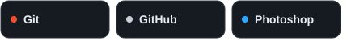

  
  
Interfaces, APIs e ideias que viram projetos.

  

    <a href="https://www.linkedin.com/in/nicolas-marques-5b7280246/">LinkedIn</a>
    &nbsp; · &nbsp;
    <a href="mailto:nicolas360@hotmail.com.br">E-mail</a>
    &nbsp; · &nbsp;
    <a href="https://github.com/kZNick?tab=repositories">Projetos</a>
  

  

## Oi, eu sou o Nicolas 👋

Desenvolvedor full stack de Goiânia, GO. Trabalho com interfaces em **React**, APIs com **Node.js / Express** e **Python / Django**, além de bancos de dados relacionais.

Gosto de construir aplicações completas: da interface e suas animações à autenticação, validação dos dados e integração com o back-end.

## Minha stack

### Front-end

React Router · styled-components · GSAP · React Hook Form · Axios

### Back-end e dados

Django REST Framework · APIs REST · autenticação com JWT · validação com Zod

### Ferramentas e design

## Minhas contribuições 🐍

<picture>
  <source media="(prefers-color-scheme: dark)" srcset="https://raw.githubusercontent.com/kZNick/kZNick/output/github-contribution-grid-snake-dark.svg">
  <source media="(prefers-color-scheme: light)" srcset="https://raw.githubusercontent.com/kZNick/kZNick/output/github-contribution-grid-snake.svg">
  
</picture>

---

  Vamos conversar? <a href="https://www.linkedin.com/in/nicolas-marques-5b7280246/">LinkedIn</a> · <a href="mailto:nicolas360@hotmail.com.br">nicolas360@hotmail.com.br</a>

