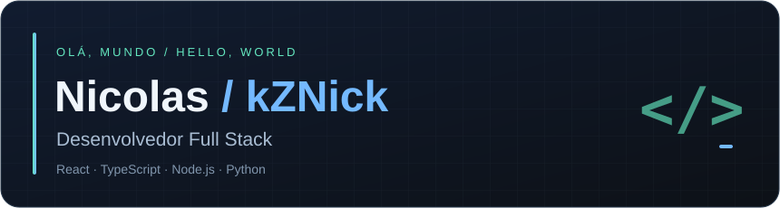

  
  
Do firmware à interface. Do protótipo digital ao produto físico.

  

    <a href="https://www.linkedin.com/in/nicolas-marques-5b7280246/">LinkedIn</a>
    &nbsp; · &nbsp;
    <a href="mailto:nicolas360@hotmail.com.br">E-mail</a>
    &nbsp; · &nbsp;
    <a href="https://github.com/kZNick?tab=repositories">Projetos</a>
  

  

## Oi, eu sou o Nicolas 👋

Sou desenvolvedor de Goiânia, GO. Trabalho com **desenvolvimento full stack, sistemas embarcados, IoT e automação**, conectando hardware, servidores e aplicações web.

Também desenvolvo aplicações com **inteligência artificial**, crio interfaces e trabalho com **impressão 3D e prototipagem funcional**. Gosto de transformar ideias em soluções completas — do firmware e da comunicação em tempo real aos dashboards e produtos físicos.

## Desenvolvimento web e mobile

**Front-end:** HTML5, CSS3, styled-components, React Router DOM, Context API, Axios, React Hook Form e Yup. Interfaces responsivas, componentização, gerenciamento de estado, integração com APIs REST, dashboards e interfaces de monitoramento.

**Back-end:** APIs REST, WebSockets e comunicação em tempo real, JWT, bcrypt, validação de dados e integração com sistemas externos. Arquitetura de aplicações, regras de negócio e Django REST Framework.

**Banco de dados:** PostgreSQL · Microsoft SQL Server · Oracle Database · SQL. Modelagem, consultas, relacionamentos e integração com APIs.

## Infraestrutura, servidores e redes

Deploy, servidores e conectividade

- Deploy e hospedagem de aplicações; configuração e manutenção de ambientes de desenvolvimento.
- Servidores web, Nginx, proxy reverso, HTTPS e TLS.
- Git, GitHub, SSH, Cloudflare e Vercel.
- Redes TCP/IP, IPv4, IPv6, VPN e redes privadas.
- Diagnóstico de conectividade em Linux e Windows.

## Sistemas embarcados, eletrônica e IoT

Integração entre **hardware e aplicações web**, automação e monitoramento remoto de equipamentos.

Firmware, eletrônica e protocolos

- Programação em C, ESP32, ESP-IDF e FreeRTOS.
- LoRa, comunicação de rádio, UART, I²C, GPIO e PWM.
- Sensores analógicos e digitais; ADS1115 e MCP23017.
- Entradas e saídas industriais, relés e automação.
- Desenvolvimento de protocolos, CRC, ACK e tratamento de mensagens.
- NVS e persistência de configurações.
- Tarefas embarcadas, watchdog e diagnóstico de firmware.
- Comunicação com servidores via WebSocket.

## Inteligência artificial

**TensorFlow.js** · aplicações com IA · integração de modelos e APIs · tratamento e análise de dados · simulações e algoritmos · automação de processos.

Uso ferramentas de programação assistida por IA e experimento geração de imagens, vídeos e animações. Tenho interesse em aprofundar **aprendizado por reforço e agentes inteligentes**.

## Design e comunicação visual

UI/UX, design responsivo, layouts para sites e identidade visual aplicada a projetos. Criação e adaptação de artes, preparação de etiquetas e materiais para impressão, tratamento e composição de imagens e apresentação visual de produtos.

## Impressão 3D e fabricação digital

**FDM · Anycubic Kobra X · STL / 3MF · PLA / PLA Silk · impressão multicolorida**

Da preparação do arquivo ao produto

- Preparação e fatiamento de arquivos; configuração de parâmetros de impressão.
- Calibração, velocidades, temperaturas e paredes com Arachne.
- Suportes, preenchimento, pontes e uso de diferentes filamentos.
- Ajustes dimensionais, tolerâncias e planejamento de peças com encaixes.
- Prototipagem funcional e desenvolvimento de produtos físicos.
- Uso de IA como apoio à modelagem 3D.
- Cálculo de custos e precificação de produtos impressos.

## Minhas contribuições 🐍

<picture>
  <source media="(prefers-color-scheme: dark)" srcset="https://raw.githubusercontent.com/kZNick/kZNick/output/github-contribution-grid-snake-dark.svg">
  <source media="(prefers-color-scheme: light)" srcset="https://raw.githubusercontent.com/kZNick/kZNick/output/github-contribution-grid-snake.svg">
  
</picture>

---

  Vamos conversar? <a href="https://www.linkedin.com/in/nicolas-marques-5b7280246/">LinkedIn</a> · <a href="mailto:nicolas360@hotmail.com.br">nicolas360@hotmail.com.br</a>

